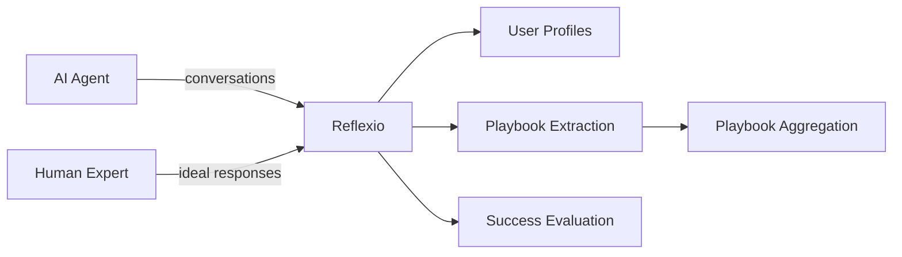
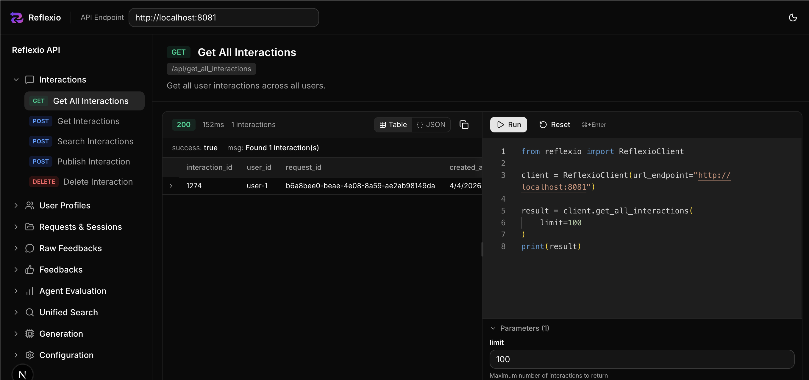

<p align="center">
  <a href="https://github.com/reflexio-ai/reflexio">
    
  </a>
</p>
<div align="center">

[](https://www.python.org/)
[](LICENSE)
[](https://pypi.org/project/reflexio-ai/)
[](https://pepy.tech/project/reflexio-ai)
[](reflexio/benchmarks/retrieval_latency/results/report.md)
[](https://github.com/ReflexioAI/reflexio/stargazers)
[](https://discord.gg/7fnCxahase)

<a href="https://www.producthunt.com/products/reflexio-2?embed=true&amp;utm_source=badge-top-post-badge&amp;utm_medium=badge&amp;utm_campaign=badge-reflexio-2" target="_blank" rel="noopener noreferrer"></a>

[Quick Start](#quick-start) · [Features](#features) · [Integrations](#integrations) · [SDK](#sdk-usage) · [CLI](reflexio/cli/README.md) · [Architecture](#architecture) · [Docs](https://www.reflexio.ai/docs) · [Community](#community) · [Contributing](#contributing)

</div>

---

<p align="center">
  <b>81% fewer planning steps</b> &nbsp;·&nbsp; <b>72% less tokens</b> &nbsp;·&nbsp; on real GDPVal knowledge-work tasks, <br/>
  <i>on top of</i> what a SOTA self-improving Hermes agent already learns on its own.<br/>
  <a href="benchmark/gdpval/RESULTS.md"><b>See the benchmark →</b></a>
</p>

---

### Try managed Reflexio free

Prefer a hosted experience? **[Start at Reflexio.ai](https://www.reflexio.ai) for free and get a 30-day Pro trial.** Managed Reflexio includes advanced features such as enhanced retrieval and continuous RL-driven improvement—without infrastructure to operate yourself.

---

## What is Reflexio?
Reflexio is an **AI agent self-improvement harness** that enables your AI agents to continuously learn from real user interactions. It turns user corrections into persisted behavioral improvements for agents and captures successful execution paths for reuse.

User-specific learnings stay scoped to that user; lessons that recur across users can be aggregated into shared agent playbooks and approved for reuse.

As your agent is used more, it becomes smarter, faster, and more effective at solving domain-specific tasks.
The moat for AI agents is what your agent learns from every interaction it handles.  

Our vision is that AI systems should get better with every interaction.

> **Benchmarked on GDPVal**: on 4 of 5 real knowledge-work tasks from OpenAI's public GDPVal benchmark, Reflexio cuts a **median −81% planning steps and −72% tokens** on a Hermes agent running `minimax/MiniMax-M2.7` — measured against a *warm baseline*: the same agent re-running the task after it has already learned from itself. In other words, Reflexio's savings come **on top of** what a SOTA self-improving agent has learnt on its own. See the full writeup → [benchmark/gdpval/RESULTS.md](benchmark/gdpval/RESULTS.md).



Publish conversations from your agent, and Reflexio closes the self-improvement loop:

- **Never Repeat the Same Mistake**: Transforms user corrections and interaction signals into improved decision-making processes — so agents adapt their behavior and avoid repeating the same mistakes.
- **Lock In What Works**: Persists successful strategies and workflows so your agent reuses proven paths instead of starting from scratch.
- **Transfer Learning Across Users**: Corrections and successful strategies that recur across users can be aggregated into shared agent playbooks; approved playbooks improve the agent for everyone without retraining.
- **Learn from Human Experts**: Publish expert-provided ideal responses alongside agent responses — Reflexio automatically extracts actionable playbooks from the differences.

> **For developers**: See [developer.md](developer.md) for project structure, environment setup, testing, and coding guidelines.

## Table of Contents

- [Demo](#demo)
- [Quick Start](#quick-start)
- [Features](#features)
- [Integrations](#integrations)
- [SDK Usage](#sdk-usage)
- [Architecture](#architecture)
- [Documentation](#documentation)
- [Community](#community)
- [Contributing](#contributing)
- [Star History](#star-history)
- [License](#license)

## Demo

<p align="center">
  
</p>

## Quick Start

### Prerequisites

| Tool | Description |
| --- | --- |
| [Python](https://www.python.org/) >= 3.12 | Required for PyPI and source installs |
| [uv](https://docs.astral.sh/uv/getting-started/installation/) | Required when running from source |
| Python's linked SQLite runtime | >= 3.35.0 (required for local SQLite storage; not the standalone `sqlite3` CLI) |
| [Node.js](https://nodejs.org/) >= 18 | Required only for the local docs site in a source checkout |

Check the SQLite runtime linked to Python with:

```shell
python -c "import sqlite3; print(sqlite3.sqlite_version_info)"
```

<p align="center">
  
</p>

### Setup

**Option A — Install from PyPI** (fastest, for users):

```shell
pip install reflexio-ai

# start/stop services. data saved under ~/.reflexio
reflexio services start           # API (8061), inference (8069), SQLite storage
reflexio services stop            # Stop all services
```

The PyPI package does not ship the local docs site. Use the
[hosted documentation](https://www.reflexio.ai/docs), or clone the repository
if you want to run the docs locally.

**Option B — Clone from source** (for contributors):

```shell
# clone the repo
git clone https://github.com/ReflexioAI/reflexio.git
cd reflexio

# configure: copy env template, then set at least one LLM API key (OpenAI, Anthropic, etc.)
cp .env.example .env

# install dependencies
uv sync                                    # Python (includes workspace packages)
npm --prefix docs install                  # API docs

# start/stop services. data saved under ~/.reflexio
uv run reflexio services start             # API (8061), Docs (8062), inference (8069), SQLite
uv run reflexio services stop              # Stop all services
```

> Source-checkout alternatives: `python -m reflexio.cli services start` or `./run_services.sh`

The standalone server listens on loopback by default and needs no API key for
local use. To allow network clients, set `REFLEXIO_API_KEY`, start with
`--backend-host 0.0.0.0`, and send `Authorization: Bearer <key>` on data requests.
Use TLS for network access. Without a key, remote clients and nonlocal browser
origins cannot access data endpoints. See [standalone access](developer.md#standalone-oss-access).

When the backend is selected, the launcher also starts the local inference
service on port 8069 unless `REFLEXIO_EMBEDDING_SERVICE_URL` points to a remote
service. It serves embeddings and the optional cross-encoder reranker; cloud
embedding configurations still use it for reranking. The deployment-wide
`REFLEXIO_RERANK_ENABLED` flag defaults to `true`. Set it to `false` to skip
reranker model loading/prewarm and disable reranker requests. Automatic
unified-search relevance flooring (which includes reranking) remains separately
off by default through `retrieval_floor.enabled`. If the loopback inference
service is unavailable, automatic reranking is silently skipped and retrieval
order is preserved. An unavailable remote/internal service is reported while
search still fails open.

The default local model, `local/minilm-l6-v2`, uses ONNX Runtime, tokenizers,
and NumPy directly; ChromaDB is not required. It retains the existing
384-dimensional MiniLM vectors padded to 512 dimensions and the cache at
`~/.cache/chroma/onnx_models/all-MiniLM-L6-v2/onnx`. A cold cache downloads the
~80 MB model archive and verifies its SHA-256 before extraction. Prepopulate
this cache for offline use; existing MiniLM databases do not need reindexing.

For a source checkout, open **[http://localhost:8062](http://localhost:8062)**
to interactively browse and try out the API.
<p align="center">
  
</p>

### Try it in 30 seconds (CLI)

Reflexio ships a first-class CLI — the fastest way to see the loop end-to-end with no code. Publish a real multi-turn conversation where the user **corrects** the agent (that's the signal Reflexio learns from), then search for what was extracted. In a source checkout, prefix these commands with `uv run`.

```shell
reflexio publish --user-id alice --session-id deploy-demo-1 --wait --data '{
  "interactions": [
    {"role": "user",      "content": "Deploy the new service."},
    {"role": "assistant", "content": "Starting deployment to us-east-1..."},
    {"role": "user",      "content": "Wait — we never deploy production to us-east-1. Always use us-west-2."},
    {"role": "assistant", "content": "Understood. Switching to us-west-2."}
  ]
}'

# Search the extracted profiles and playbooks
reflexio search "deployment region" --user-id alice
```

Depending on the configured model and extraction gates, this conversation can
produce a user profile (`production region is us-west-2`) and a user playbook
(`confirm region before deploying`). Agent playbooks are created later by
aggregating recurring user playbooks across users and enter the approval
workflow. See the [CLI reference](reflexio/cli/README.md) for all input modes
(inline JSON, `--file`, `--stdin`) and the full command list.

### Integrate with the Python SDK

```python
import reflexio

client = reflexio.ReflexioClient(
    url_endpoint="http://localhost:8061/"
)

# A conversation is a session. Bind it once, then every call you make
# through `session` carries it — so the searches that fed the agent and
# the turns you publish stay linked to each other.
session = client.for_session("deploy-demo-1")

# Publish a multi-turn conversation where the user corrects the agent —
# Reflexio can extract a profile ("prod region = us-west-2") and a playbook
# ("confirm region before deploying").
session.publish_interaction(
    user_id="alice",
    interactions=[
        {"role": "user",      "content": "Deploy the new service."},
        {"role": "assistant", "content": "Starting deployment to us-east-1..."},
        {"role": "user",      "content": "Wait — we never deploy production to us-east-1. Always use us-west-2."},
        {"role": "assistant", "content": "Understood. Switching to us-west-2."},
    ],
)
```

By default, Reflexio queues profile and playbook extraction in the background;
the configured models and extraction gates determine which artifacts are produced.
Large textual windows preserve original sources and freeze their chunk plan before
provider work. Audited playbook reconciliation may use verified model input
headroom beyond the ordinary extraction target; output reservations, safety margin
and durable call limits still apply. Held capacity failures require explicit
operator recovery with the original journal, rather than fresh automatic quota.

### Integrate with the TypeScript SDK

```shell
npm install @reflexioai/client
```

```ts
import { ReflexioClient } from "@reflexioai/client";

const client = new ReflexioClient({ url: "http://localhost:8061/" });

// Same calls and field names as the Python SDK, camelCased method names.
const session = client.forSession("deploy-demo-1");

await session.publishInteraction({
  user_id: "alice",
  interactions: [
    { role: "user", content: "Deploy the new service." },
    { role: "assistant", content: "Starting deployment to us-east-1..." },
    { role: "user", content: "Wait — we never deploy production to us-east-1. Always use us-west-2." },
    { role: "assistant", content: "Understood. Switching to us-west-2." },
  ],
});

const context = await session.search({ query: "deploy the service", user_id: "alice" });
```

See [`client_ts/`](client_ts/README.md) for the full TypeScript client guide.

## Features

### Profile Generation

- Extracts stable facts about users and their environments with one configurable profile extractor
- Supports versioning (current → pending → archived) with upgrade/downgrade workflows
- Supports global extraction windows and strides with profile-specific overrides

[Read more about user profiles →](https://www.reflexio.ai/docs/concepts/user-profiles)

### Playbook Extraction & Aggregation

- Extracts playbooks from user behavior patterns
- Clusters similar entries and aggregates with LLM (with change detection to skip unchanged clusters)
- Approval workflow: review and approve/reject agent playbooks

Playbook consolidation uses one independently audited method. It drafts
Create/Replace/Remove decisions, audits the complete proposed memory, and repairs
affected decisions before saving. Replace can produce multiple playbooks. One
24-request allowance covers draft, read-only searches, audits, repairs and provider
fallback attempts. A nonempty batch requires a draft and audit even when no
incumbent matches. Exhaustion or failed audits preserve committed memory; drafts
are never saved as a fallback. Candidate search threshold and top-k remain
independent controls.

New candidates require persisted, owner-scoped source evidence. Expert examples
with persisted source observations are supported. Missing new evidence causes
consolidation to abstain. Missing historical evidence alone does not invalidate
an existing playbook. Manual publication remains available through its own API.
The historical `deduplication_config.strategy` selector is retired: explicit
configuration upgrades preserve originals and remove either known selector value.
Rollback uses the previous release and its original configuration, rather than a
second runtime engine. This standardization does not establish online quality or
cost improvements; measure those separately.

[Read more about agent playbooks →](https://www.reflexio.ai/docs/concepts/agent-playbook)

### Expert Learning

- Publish human-expert ideal responses alongside agent responses via the `expert_content` field
- Reflexio automatically compares agent vs. expert responses, focusing on substantive differences (missing info, incorrect approach, reasoning gaps) while ignoring stylistic ones
- Generates actionable playbooks as trigger/instruction/pitfall SOPs that teach the agent what to do differently

[Read more about interactions & expert content →](https://www.reflexio.ai/docs/build/user-interactions#expert-examples)

### Agent Success Evaluation

- Session-level evaluation sampled automatically (5% by default) and scheduled 10 minutes after the session's last request
- Per-turn head-to-head comparison when an assistant interaction includes `shadow_content`
- Tool usage analysis for blocking issue detection
- Source-set comparison groups evaluated sessions by the first request's `source`; it supports a causal claim only when sessions are assigned randomly

[Read more about evaluation →](https://www.reflexio.ai/docs/build/agent-evaluation)

### Search & Retrieval

- Hybrid search (vector + full-text) across profiles and playbooks
- Optional LLM-powered query reformulation for improved recall
- Unified search across all entity types in parallel
- **Fast at scale**: unified search across ~3,000 indexed rows (profile + user playbook + agent playbook, ~1,000 rows each, queried in parallel) runs at **~57 ms p50 / ~73 ms p95** — measured service-layer with local SQLite on an Apple Silicon MacBook, 30 trials × 20 fixed queries. See the [full benchmark report](reflexio/benchmarks/retrieval_latency/results/report.md) or reproduce with [`reflexio.benchmarks.retrieval_latency`](reflexio/benchmarks/retrieval_latency/README.md).

### Multi-Provider LLM Support

- OpenAI and Azure OpenAI, Anthropic, OpenRouter, Google Gemini, MiniMax, DeepSeek, DashScope/Qwen, Zhipu AI/GLM, Moonshot/Kimi, xAI/Grok, and custom OpenAI-compatible endpoints
- Powered by LiteLLM — configure your preferred provider via API keys or custom endpoints
- [OpenAI-compatible gateway configuration and verified limits](developer.md#openai-compatible-gateways-including-orcarouter-492)

## SDK Usage

For detailed API documentation, see the [full API reference](https://www.reflexio.ai/docs/api-reference).
For TypeScript and JavaScript, use [`@reflexioai/client`](client_ts/README.md); the examples below are Python.

Install the package:

```shell
pip install reflexio-ai
```

### Basic usage

```python
import reflexio

client = reflexio.ReflexioClient(
    url_endpoint="http://localhost:8061/"
)

# Bind the conversation's session id once. Recommended: it keeps the
# searches that retrieve context and the turns you publish correlated,
# which is what lets Reflexio tell whether a learning actually helped.
session = client.for_session("session-abc")

# Retrieve context for this turn
context = session.search(query="deployment region preference", user_id="user-123")

# Publish interactions
session.publish_interaction(
    user_id="user-123",
    interactions=[
        {"role": "user",      "content": "..."},
        {"role": "assistant", "content": "..."},
    ],
    agent_version="v1",       # optional: track agent versions
)

# Search profiles
profiles = client.search_user_profiles(
    user_id="user-123",
    query="deployment region preference",
)

# Search agent playbooks
playbooks = client.get_agent_playbooks(agent_version="v1")
```

### Configuration

```python
# Apply a targeted configuration change without resending the full Config.
client.update_config({
    "window_size": 20,
    "stride_size": 10,
})
```

Use `set_config()` only when replacing the complete configuration, including
its required `storage_config`.

## Integrations

Reflexio integrates with popular AI agent frameworks out of the box:

- **[OpenClaw](reflexio/integrations/openclaw/README.md)** -- Native integration with the OpenClaw agent framework.
- **mem0** -- Drop-in wrapper for the mem0 managed-platform client.

### mem0 drop-in wrapper

Already using [mem0](https://mem0.ai)? Install the extra and change one import —
no other code changes:

```bash
pip install 'reflexio-ai[mem0]'
```

```python
# Before
from mem0 import MemoryClient
# After
from reflexio.mem0 import MemoryClient

client = MemoryClient(api_key="your-mem0-key")
```

Hosted sync and async `add()` calls still run mem0 first, then best-effort
publish the same conversation to Reflexio. Normal `search()` is exactly mem0:
it makes no Reflexio call and returns mem0's original object. Opt in when you
want both result sets:

```python
result = client.search(
    query,
    filters={"user_id": "user-123", "agent_id": "support-bot"},
    include_reflexio=True,
)
memories = result["results"]
learnings = result["reflexio"]
```

`learnings` contains a stable status, reason, profiles, user playbooks, and
agent playbooks. Reflexio never rewrites the query or injects these values into
a prompt; the application decides how to validate and format retrieved text as
prompt context. Reflexio credentials come from `REFLEXIO_API_KEY` and
`REFLEXIO_URL`, or can be passed directly as `reflexio_api_key=` with optional
`reflexio_url_endpoint=`. Advanced callers can instead inject
`reflexio_client=ReflexioClient(...)`. Wrapper-created clients use a five-second
timeout. Reflexio failures never change a successful mem0 `add()` result and are
represented safely in opted-in search results.

`client.reflexio` exposes scoped Reflexio cleanup methods. Inherited mem0
`delete*` methods and `reset()` remain mem0-only. `MemoryClient` and
`AsyncMemoryClient` are wrapped; local `Memory` and `AsyncMemory` remain exact
mem0 exports. The integration supports `mem0ai>=2.0,<2.1`.

> **Migration from the removed LangChain integration.** The
> `reflexio.integrations.langchain` package and its optional extra have been
> removed. To inject Reflexio context into a LangChain chain or
> agent, call the Reflexio client's search API directly and add the formatted
> results to your prompt (e.g. as a system message) — no framework-specific glue
> is required.

## Architecture

```
Client (SDK / CLI / HTTP API)
  → FastAPI Backend
    ├─ ProfileGenerationService  → ProfileExtractor → Consolidator → Storage
    ├─ PlaybookGenerationService → UserPlaybookExtractor → Consolidator
    │                              → User playbooks (Storage)
    │                              → Aggregator → Agent playbooks (Storage)
    ├─ GroupEvaluationScheduler  → AgentSuccessEvaluator → Storage
    │                              (sampled; deferred 10 min)
    ├─ ShadowComparisonWorker    → Per-turn judge → Storage
    └─ UnifiedSearchService      → Profiles + user/agent playbooks
```

The import-light [inference launch resolver](reflexio/inference_launch.py) gives
providers and launchers one endpoint and process-ownership contract. An explicit
service URL attaches to an existing inference process; otherwise the launcher
owns a separate child. See [developer.md](developer.md) for migration and runtime details.
The shared legacy boolean parser lives in [env_utils.py](reflexio/env_utils.py)
so launchers can reuse it without importing server startup. The existing
`reflexio.server.env_utils.env_truthy` import remains a compatibility export.

The [native CLI controller](reflexio/server/llm/_native_cli.py) retains a fresh
[launch owner](reflexio/server/llm/_native_cli_process.py) through immediate
Claude/Codex/OpenClaw exit and file cleanup after an isolated SDK worker exits. See [worker ownership](docs/completion-worker-ownership.md) for guarantees
and descendant limits. Timeout grace remains supported.

See [developer.md](developer.md) for project structure, supported LLM providers, and development setup.

## Documentation

For comprehensive guides, examples, and API reference, visit the **[Reflexio Documentation](https://www.reflexio.ai/docs)**.

For coding agents adding Reflexio to another agent, use the portable
**[`integrate-reflexio` skill](skills/integrate-reflexio/SKILL.md)**. Read
**[Integrating an AI Agent with Reflexio](AI_AGENT_INTEGRATION.md)** for
supporting concepts and background.
Copy the skill into the agent application's repository for Codex, Claude Code,
or Cursor, or point a coding agent at the linked skill while it works in that
application repository. The skill is not intended to modify Reflexio itself.
It checks for supported tracing already in use and helps choose between connecting
that data source and publishing interactions directly, while integrating retrieval
for either method.

For agents already logging to Braintrust, use [Connect a data source](skills/connect-data-source/SKILL.md)
to prepare and validate importing through the setup API. The developer reviews the saved
configuration and activates in Reflexio; no plugin or additional publish flow is needed.

## Community

Join the Reflexio community on Discord: [discord.gg/7fnCxahase](https://discord.gg/7fnCxahase).

## Contributing

We welcome contributions! Please see [developer.md](developer.md) for guidelines.

## License

This project is currently licensed under [Apache License 2.0](LICENSE).

### Durable extraction catch-up

Publishing commits interactions before returning success. Background workers process
configured sliding windows in admission order, regardless of request boundaries.
Different users can extract concurrently within `REFLEXIO_PUBLISH_LEARNING_WORKERS`
(default 4 per process); each user's profile/playbook cursors retry independently.
A failing window retries with backoff capped at five minutes, up to 12 attempts
(about 18 minutes); the 12th failure parks the cursor, logs one ERROR naming the
failure's source location, and reports `failed` with reason `retry_exhausted`.
An operator re-arms it with
`reflexio.server.services.extraction.input_recovery.plan_input_budget_recovery`
then `apply_input_budget_recovery`; a re-armed window gets one more attempt.
A partial window is evaluated after an optional completion hint or six hours of
session inactivity by default. Both paths retain the usefulness judge; a negative
judge result covers the input without generating learnings. Normal full windows
and strides run as before. Later messages in a finalized session remain valid.

For operational measurement, `storage.learning_completion_report(start, end)`
reports a mature acceptance cohort of at most 24 hours, using server acceptance
time through coverage by every required extractor. Each publish counts once;
queue waits and retries count toward the fixed 60-second target. Empty valid
results count as coverage. The report includes overdue unfinished work and
unknown historical completion times in its denominator; erased/inapplicable
inputs are explicit exclusions. It reads only bounded metadata pages, raises
on incomplete pagination or its row cap, and cannot reconstruct erased or
expired records. Window completion timestamps are recorded inside the fenced
commit transaction and survive acknowledgement; older receipts stay unknown.

```python
client.publish_interaction(user_id="u", session_id="s", interactions=messages,
                           session_finished=True)
# Or signal completion after messages were already saved:
client.finalize_session(user_id="u", session_id="s")
```

Completion returns acceptance, not extraction completion. The async and
`client.for_session("s")` APIs support the same operation. Set Config's
`extraction_idle_timeout_seconds` (default `21600`; `0` disables fallback for new
publications). This is a configurable low-urgency policy, not proof that a session
ended. Activity is scoped by organization/project/user/session; other sessions do
not postpone its deadline. Each publication captures its timeout, so edits apply
to subsequent publications. Existing pre-upgrade admissions have no inferred
idle deadline; explicitly finalize those surviving sessions when needed.
The library scheduler needs a live process and reachable `Reflexio` handle;
reopening resumes durable deadlines without another publish.
Provider fallback remains enabled. Existing extracted data is preserved, and
interactions stored before stream admission are not automatically replayed.

Upgrade retries preserve admitted extraction windows, original configuration hashes,
snapshots and saved output. Ordinary and overflow retries accept known inert
schema changes: removal of `extractor_name`, the unused playbook `context_prompt`
and the retired deduplication warning threshold. For extraction-phase recovery,
a historically absent, `"legacy"`, or `"audited"` consolidation selector is also
compatible: it never controlled extraction. Compatibility requires both
the saved run and frozen window policy to prove the original hash. Historical
prior-answer lookups retain the old representation. Selected finalization recovery
also authenticates its saved snapshot before applying these comparisons. Changed
prompts, live profile context, identities, search settings and unknown removed
fields remain rejected. Old consolidation proposals are not audited approvals;
new consolidation draws from the original window's remaining physical-call
allowance. Existing audited conversations retain exact payload, prompt, model and
transport bindings. Saved write plans replay without recomputing decisions. No
cursor reset or deletion of pending work is needed.
The playbook context field is no longer exposed or serialized as configuration;
profile context remains supported. Raw upgrades preserve old unused text as opaque
data. A separate durable snapshot adapter keeps the historical nullable metadata
slot for old workers, and retains witnessed values when continuing admitted work.
New job hashes therefore remain readable by the previous worker schema. This slot
is not a configuration input or execution default. Older operator-selected recovery
may refuse new neutral snapshots when an old raw org config has custom context;
use the upgraded recovery worker/tool in that case. Such refusals leave work intact.

Overflow extraction meters source input using the complete original primary
fields once, rejoining their pieces before canonical `cl100k_base` tokenization.
Neighbor context, evidence framing and repeated model calls do not multiply this
source-input count. Provider prompt, output and cache totals separately retain
all observed calls, and the durable billing snapshot survives delivery retries.
Legacy extraction keeps its existing input formatter and billing behavior.

A caller waiting for coverage — `publish_interaction()`, or `POST
/api/publish_interaction?wait_for_response=true` — is never held for a window only
new input can close. It returns as soon as every eligible cursor is either covered
or waiting for input, reporting `learning_status="deferred"` with
`learning_reason="waiting_for_window"`. Poll `GET /api/learning_status` with the
returned `request_id` to see coverage complete later. Note the practical
consequence of the default `window_size` of 10: a brand-new user's first window
normally needs ten eligible interactions, so an incomplete first publish returns
uncovered until more input, an optional completion hint, or its idle deadline.
Reserve `force_extraction` for an explicit manual bypass of the judge.

### Nomic dependency compatibility

The full package requires Transformers 5.6.2 or newer and uses its native Nomic
implementation with remote model code disabled. There is no Transformers upper
cap in Reflexio's requirement. The checkpoint, task prefixes, pooling, 8192-token
sequence limit and normalized 512-dimensional vectors remain the same; serialized
access to the shared model is preserved.

For release qualification, install the built full wheel into a fresh environment
and run `scripts/verify_nomic_artifact.py` with that environment's Python from
outside the checkout. It rejects editable imports and exercises real short and
long inference, checking the native model and finite normalized vectors. Model
weights must be cached or downloadable. Run with `OMP_NUM_THREADS=1` and
`OPENBLAS_NUM_THREADS=1`; the verifier caps Torch at two threads. This is keyless,
not a paid LLM test. Loading weights alone is insufficient qualification.

Native/legacy diagnostic parity matched on the sampled short/medium inputs and
one 2,346-token input before this migration. This establishes bounded evidence,
not equivalence for every possible input. The opt-in real-model concurrency and
long-input tests fail on load/inference errors when enabled:

```bash
RUN_LOW_PRIORITY=1 nice -n 10 uv run pytest tests/server/llm/test_nomic_embedding_realmodel_concurrency.py -o addopts=
```

### Optional isolated query embeddings

Deployments may set `REFLEXIO_QUERY_EMBEDDING_SERVICE_URL` to a separate query-only
worker. The ordinary embedding endpoint continues to handle stored documents
and reranking. `LiteLLMClient.get_embedding` and `get_embeddings` accept a
keyword-only `purpose="query"`; the default is `"document"`. Storage supplies
this purpose explicitly, independently of text prefixes or request priority.
Cloud embedding models retain their normal provider route. Both local endpoints
must advertise identical immutable model, revision and dimension contracts at
`/health/model`, and the query endpoint must advertise `workload="query"`. An
empty query URL retains shared routing. Changing an endpoint's model requires
restarting API workers; a failed query endpoint never fails over to shared CPU.

When constructing workers with `create_embedding_app`, supply a `model_contract`
callback returning the loaded encoder's `model`, pinned `revision`, and
`dimensions` on both apps. The factory exposes `/health/model` and derives
the embedding `workload` from admission policy. Without that callback it returns 503 rather than
inventing a revision. Additional metadata such as device and thread count can
be returned by the callback.

### Search priority on a shared CPU worker

Explicit query embedding requests always forward `purpose="query"`, including
when routed to the shared inference endpoint. Full-search reranking forwards
`priority="search"`; generic profile reranking retains interactive priority.
The embedding service passes these classifications to its injected inference
scheduler. An older reranking service ignores the new optional field and
continues its existing interactive behavior.

The enterprise CPU scheduler uses the same models and worker for all work.
Search gets priority between model chunks, with a turn for other queued
interactive work after at most four search chunks and a bulk turn after at
most 32 foreground chunks. Each foreground queue keeps earliest-deadline
ordering; cancellation, request deadlines, vector contents, and rerank policy
are unchanged. This needs no additional worker or load balancer. Deploy the
updated worker before the API, and verify full-search latency under competing
interactive and bulk work before production promotion.

### Optional reserved search reranking

`create_embedding_app(workload="search", ...)` keeps query-only embedding
admission and enables the configured reranker. Its `/health/model` still reports
`workload="query"`, so existing embedding clients can coexist during a rolling
upgrade; `/health` separately advertises the `search` workload and reranker readiness.
Legacy `query_only=True` remains embedding-only and rejects reranking.
Search workers require a successful reranker prewarm before serving. If a later
prediction fails, `/health` and `/health/rerank` can retry one warmup under a
one-second request budget. Recovery uses the existing inference scheduler when
supplied; overlapping health probes never run overlapping warmups, including
when a slow prediction continues after its health request times out. The worker
remains unready until a real prediction succeeds.

Set `REFLEXIO_SEARCH_RERANK_SERVICE_URL` to the same endpoint as
`REFLEXIO_QUERY_EMBEDDING_SERVICE_URL` to route retrieval relevance scoring there.
The client verifies matching immutable vector contracts, the same configured
reranker as the shared worker, and a ready search workload. Generic
`score_pairs`/`score_pairs_with_model` calls keep shared routing; retrieval uses
the explicit `score_search_pairs` helpers. Unset search routing preserves the
existing path. Failed isolated calls do not retry against the shared worker;
retrieval retains its existing unavailable-reranker behavior and deadlines.

Local inference uses one CPU numerical-library budget, `REFLEXIO_NATIVE_COMPUTE_THREADS`
(positive integer, default **2**). The owner in `reflexio/native_compute.py`
configures Torch, loaded BLAS/OpenMP runtimes and ONNX intra-op sessions. It also
prepares native environment outputs before a managed child imports libraries.
This bounds each backend's pool, not total CPU across concurrent operations.
The model-only owner is independent of the application-wide configuration
migration registry, so unrelated setting retirements do not invalidate model asset builds.
Importing the owner in a client process has no side effects. Tokenizer fork
safety remains separately controlled by `TOKENIZERS_PARALLELISM`.

This intentionally replaces Nomic's former unset/Torch-default behavior with the
same explicit budget as E5 and MiniLM. To preserve a custom native thread limit,
choose the new budget explicitly before removing `REFLEXIO_INFERENCE_TORCH_THREADS`,
`OMP_NUM_THREADS`, `MKL_NUM_THREADS` and `OPENBLAS_NUM_THREADS` from inference input
configuration. Blank/former-default `2` assignments are ignored; other legacy
values without an explicit new budget fail before changing libraries. Legacy
values never select the new budget. See the [upgrade guide](docs/configuration-upgrade.md).

Environment-name upgrades: see the [canonical configuration guide](docs/configuration-upgrade.md) before adopting this version.
