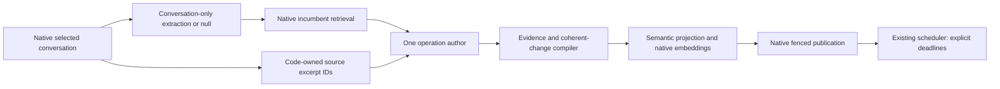

# Profile learning

One maintained profile method transfers the V28 DEV finalist from RSI Labs. The experiment selected this method on exposed development data; that result is not population accuracy or demonstrated online benefit.

The source extractor authors facts. The operation author chooses additions, carried clauses, corrections and authorized forgetting against retrieved incumbents. It returns code-owned source and span IDs. The compiler validates identities, complete old-clause accounting, coherent groups and lifetime authority; matching an excerpt establishes provenance, not semantic truth. Model judgment and assessment still own factual support. Ordinary native source filtering, overflow admission, cursor/lease ownership and repair remain native. A failed planner withholds new proposals and preserves incumbents; it does not invoke a retired engine.

`operation_author.py` owns the selected operation wire and its conversion into the internal plan. `source_evidence.py` binds original request/owner/text to excerpt IDs. `compiler.py` owns evidence, fact/action/lifetime legality and final row construction; `linked_plan.py` supplies coherent-plan accounting and independent optional term validation. `extractor.py` supplies the measured conversation-only guidance and lossless manual-source handoff. Recognized role capitalization is normalized with the original `source_role` retained; unknown speakers are never guessed to be users.

`semantic_embedding.py` excludes exact machine audit keys only from embedding input and preserves durable originals. The service calls this view locally during compute; it never replaces native storage identity, because leases and fences compare that identity. Standalone profile document expansion is replaced by optional author-supplied terms. Playbook expansion and direct storage APIs retain their defaults. A native embedding failure propagates without partially copying results.

`explicit_retention.py` distinguishes user-specified storage deadlines from estimates, unknown duration and factual validity. Only explicit retention authorizes deadline hard deletion. `stop_at D` is absent at D; `through D` remains visible at D and is due at D+1 at integer-second precision. Estimate/unknown metadata does not authorize hard deletion. Existing metadata keys remain readable to preserve earlier stored authorities.

The final resolved `_persist_write_plan` seam binds exact old versions, publishes, supersedes and purges overdue owned copies inside the native transaction. It covers inline finalization, cached plans and ordinary durable publication. Native outer failure rolls rows, lineage and bookmarks back together. Notifications occur after the outer commit through native post-commit dispatch. The scheduler uses the existing leader, background-work and org-fanout owners; there is no per-conversation daemon or new database pool. Its persisted-state discovery survives storage reconstruction; at idle, newly written cross-process work is discovered on a bounded periodic wait of at most 60 seconds, plus actual enumeration/indexed-query/admission/execution delay. This is not an exact timer SLA.

The optional explicit package executor uses the same operation author, source guidance and compiler. Its durable cache saves the original operation wire and recompiles it under the same source/snapshot books. It does not decode it as the retired merge schema. Old incompatible frozen package protocols refuse execution rather than silently adopting new behavior. Pending tools and native source-coverage/cursor/fence receipts remain independently owned.

The measured M3-only producing model ladder retains thinking disabled. Mixed-provider or other model ladders keep native provider policy; no MiniMax field is forwarded into another provider's fallback. Those other routes do not inherit M3 quality claims. Native structured-output models fold provider-unsafe schema keywords while retaining the same variants and local discriminated validation.

Qualification and release limits are recorded in the enterprise transfer plan and RSI study. No module here imports the lab runner or budget ledgers.

Deadline candidate discovery uses a project-leading persisted JSON projection index, with Python authority validation and locked version checks unchanged. Ordinary estimates are excluded. Ambiguous legacy metadata stays conservatively eligible for validation, which can cost more or fail its scope. Missing native index readiness blocks affected deadline discovery without blocking ordinary maintenance. Older writers maintain the additive index; older releases without this executor still require an explicit rollback execution plan.
